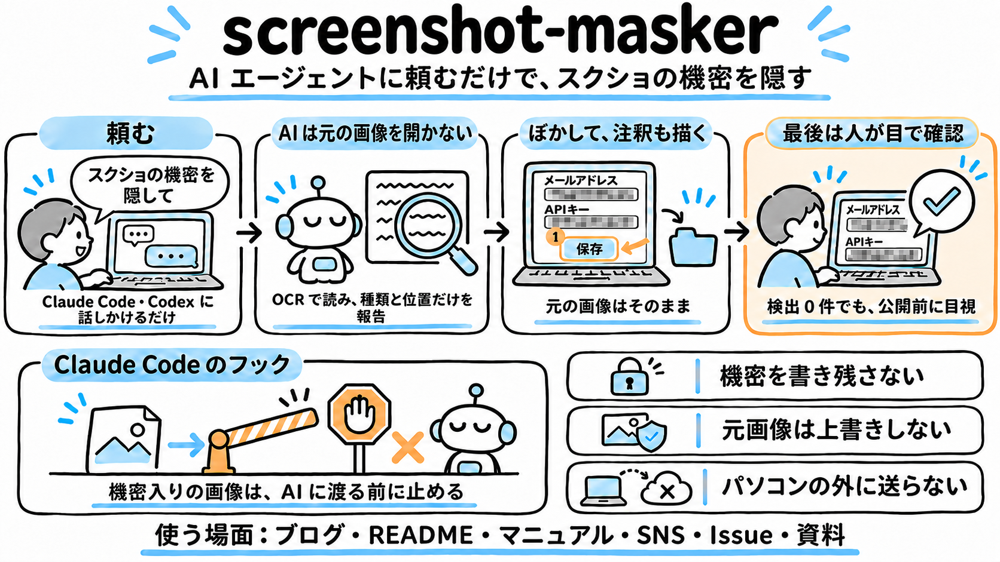
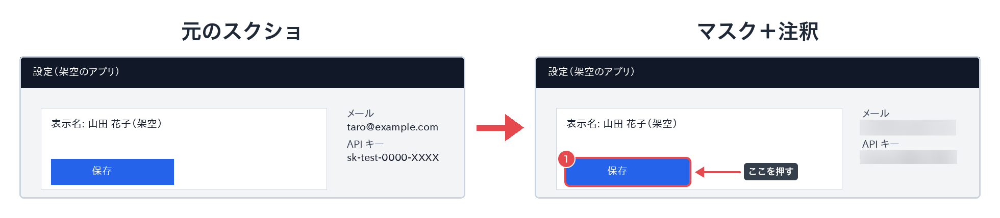

# screenshot-masker



公開・共有する前のスクリーンショットから、メールアドレス・API キー・URL・ホームディレクトリのパスなどの機密を OCR で見つけてぼかすツールです。Claude Code や Codex に「記事に載せるスクショの個人情報を隠して」と頼むだけで、エージェントはマスク前の画像を開かずに処理し、最後の目視確認をあなたに頼みます。

> [!IMPORTANT]
> OCR は文字を見落とすことがあり、検出が 0 件でも安全とは限りません。公開・共有する前に必ず人の目で確かめてください（[免責事項](#免責事項)）。



## 特徴

- **AI エージェントに任せられる。** 同梱のスキルが、元の画像や確認用画像を開かない手順をエージェントに教えます。マスクでは種類と位置だけを見て判断するので、画像に写った機密をモデルに渡さずに処理できます（Claude Code・Codex。注釈を頼んだときは、既定でマスク済みの画像を開きます ─ [注釈を描くとき](docs/AIエージェントから使う.md#注釈を描くとき)）
- **画像がエージェントに渡る前に止める（任意）。** Claude Code のフックを入れると、エージェントが画像を開くときやプロンプトに画像のパスを書いたときに OCR で調べ、機密らしい文字列があれば止めます
- **日本語のスクショに対応。** マイナンバー（検査用数字で確認）・電話番号・郵便番号など日本の形式を見分けます。API キー・トークン・`.env` の値・接続文字列・IP アドレスなど、開発者の画面に出るものも隠します（[検出する種類](docs/検出する種類.md)）
- **機密を書き残さない。** 画面に出すのはファイル名・種類・位置だけで、見つけた文字列は表示もログ保存もしません。文字の読み取りもパソコンの中で行い、インターネットには接続しません
- **元の画像はそのまま。** マスク済みの画像は別フォルダに書き出します。書き出した画像には、位置情報などの EXIF も引き継がれません
- **マスクと注釈をひと続きで。** 「機密を隠して、保存ボタンに 1 番を付けて」と頼むと、マスクした画像に枠・番号バッジ・矢印・ラベルまで描きます。見た目は設定ファイルで揃えられます（[注釈を付ける](docs/注釈を付ける.md)）

## はじめる

macOS と Homebrew での手順です（他の環境は [使い方](docs/使い方.md#必要なもの)）。

1. ツール本体（文字を読む Tesseract と screenshot-masker）を入れます

   ```sh
   brew install tesseract tesseract-lang uv
   uv tool install git+https://github.com/takunagai/screenshot-masker
   ```

2. Claude Code にスキルを入れます（Codex は [AI エージェントから使う](docs/AIエージェントから使う.md#codex)）

   ```sh
   claude plugin marketplace add takunagai/claude-plugins
   claude plugin install screenshot-masker@takunagai
   ```

3. エージェントに頼みます

   > `~/blog/images` のスクショを、公開する前に全部マスクして

   エージェントはフォルダごと処理してマスク済みの画像を別フォルダに出し、何がいくつ見つかったか（種類と位置だけ）を報告して、確認用画像での目視をあなたに頼みます。

## こう頼めます

ふだんの言葉で頼むだけです。コマンドやオプションを覚える必要はありません。

| 頼み方の例 | エージェントがすること |
| --- | --- |
| 「`~/blog/2026-11-tips/images` のスクショを、公開する前に全部マスクして」 | フォルダごと処理し、マスク済みの画像を別フォルダに出す。何がいくつ見つかったか（種類と位置だけ）を報告し、確認用画像を見て最終確認するよう頼む |
| 「エラー画面の `error.png` を GitHub の Issue に貼りたい。パスやトークンを隠して、貼れる画像にして」 | ホームディレクトリのパスや API キーをぼかした画像を用意する。元の画像は書き換えない |
| 「自社ドキュメントの URL まで消えた。`docs.example.com` は残してやり直して」 | 設定ファイルの `allowed_domains` にそのドメインを足して、もう一度処理する |
| 「スクショに写る案件コード（`PRJ-1234` の形）も隠すようにして」 | 設定ファイルに正規表現を足して、フォルダ全体をやり直す |
| 「`settings.png` の機密を隠したうえで、保存ボタンを枠で囲んで『1』の番号と『ここを押す』のラベルを付けて」 | マスクしてから、マスク済みの画像を見て位置を決め、注釈を描く。元の画像は見ない（[注釈を描くときの注意](docs/AIエージェントから使う.md#注釈を描くとき)） |
| 「マスク漏れが無いか、確認用画像を開いてチェックして」 | **確認用画像を開かずに断り**、理由（マスク前の機密が写っている）を説明して、目視をあなたに頼む |

最後の例のとおり、頼まれても機密が写った画像は開きません。この振る舞いは同梱の [eval](evals/) で確かめています。

## 画像がエージェントに渡る前に止める（任意）

スキルは「開かない」という指示ですが、Claude Code ではフックを入れると仕組みとして止められます。エージェントが画像ファイルを開くときと、プロンプトに画像のパスを書いて送るときに OCR で調べ、機密らしい文字列を見つけたら止めます。止める代わりに、マスクした写しに差し替えることもできます。

クリップボードから貼り付けた画像と、シェルのコマンドや MCP のツールが読む画像は調べられません。設定のしかたと注意点は [フックで画像を止める](docs/AIエージェントから使う.md#フックで画像を止めるclaude-code) にあります。

## コマンドで使う

エージェントを使わずに、コマンドで直接マスクすることもできます。

```sh
# 1 枚をマスクして masked/ に出力
screenshot-masker shot.png

# フォルダごと。検出範囲を赤枠で囲んだ確認用画像も <出力先>_preview/ に出す
screenshot-masker ~/Desktop/screenshots -o ~/Desktop/masked --preview

# 画像を書かずに、検出結果（ファイル名・種類・位置）だけを見る
screenshot-masker shot.png --dry-run
```

終了コードは、0 が検出なし、1 が検出あり（マスクした。エラーではない）、2 がエラーです。

> [!WARNING]
> 確認用画像（`--preview`）にはマスク前の文字がそのまま残ります。確認が済んだら消し、公開用のフォルダに混ぜないでください。

見落としを防ぐ手順は [公開までの流れ](docs/使い方.md#公開までの流れ) に、オプションと設定ファイルは [使い方](docs/使い方.md) にまとめています。

## 注釈を付ける

記事や操作マニュアル用に、枠・番号バッジ・矢印・文字ラベル・スポットライトを、指示ファイル（YAML / JSON）から描き込みます。見た目の既定値を設定ファイルにまとめれば、何枚でも同じ見た目に揃えられます。`--mask` を付けると、機密をマスクしてから描きます。

```sh
screenshot-masker annotate shot.png --spec annotate.yaml --mask
```

```yaml
annotations:
  - {type: rect, box: [40, 100, 560, 160]}     # 枠（x, y, 幅, 高さ）
  - {type: badge, at: [40, 100]}               # 番号バッジ（1, 2, 3… と自動）
  - {type: arrow, from: [420, 360], to: [300, 270]}
  - {type: label, at: [380, 365], text: "ここで「保存」を押します"}
```


指示ファイルの書き方と見た目の設定は [注釈を付ける](docs/注釈を付ける.md) にあります。

## ドキュメント

- [使い方](docs/使い方.md) ─ 導入の詳細・公開までの流れ・オプション・出力・終了コード・設定ファイル・機密の扱い
- [検出する種類](docs/検出する種類.md) ─ 既定で検出するもの・有効にしたときだけ検出するもの・検出しないもの
- [注釈を付ける](docs/注釈を付ける.md) ─ annotate の指示ファイルと見た目の既定値
- [AI エージェントから使う](docs/AIエージェントから使う.md) ─ スキルの導入（Claude Code・Codex）・フック・スキルを使わない場合
- [困ったとき](docs/困ったとき.md) ─ エラーと対処
- [開発に参加する](CONTRIBUTING.md)

## 限界

- OCR の精度に依存します。文字が小さい、背景と文字の色が近い、装飾フォントなどは見落とすことがあります。公開前に必ず目視で確認してください（`--preview` が便利です）
- 照合は行単位です。2 行に折り返した URL などは、片方の行だけが検出されることがあります
- 住所と氏名は検出しません（正規表現では確実に拾えないため）

## 免責事項

- このツールは OCR で文字を読み取るため、機密情報を見落としたり、関係のない部分を隠したりすることがあります。マスクの結果の最終確認と、公開・共有してよいかの判断は、利用者が行ってください
- このツールと同梱のスキルは、現状のまま（AS IS）提供します。動作や結果について、開発者は何も保証しません。AI エージェントから使った場合も含め、このツールを使ったことによる情報漏えいその他の損害について、開発者は法令で認められる範囲で責任を負いません
- 法的な条件は [LICENSE](LICENSE)（Apache License 2.0）の第 7 条（保証の否認）と第 8 条（責任の制限）が正本です

## ライセンス

[Apache License 2.0](LICENSE) で公開しています。Copyright 2026 Taku Nagai

OCR には別途インストールする [Tesseract](https://github.com/tesseract-ocr/tesseract)（Apache License 2.0）を使います。
