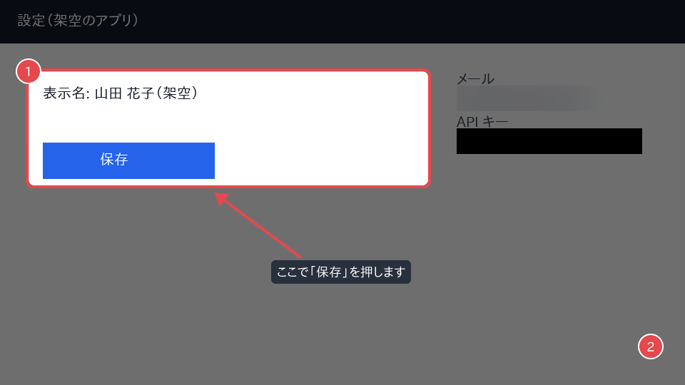

# screenshot-masker

記事や操作マニュアルに載せるスクリーンショットに、指示ファイル（YAML / JSON）から機械的に
マスクと注釈を描き込むコマンドラインツールです。同じスタイル設定を使えば、何枚でも同じ見た目の
注釈を揃えられます。元画像は上書きしません。

## 必要なもの

- Python 3.11 以上
- [uv](https://docs.astral.sh/uv/)（開発時）
- 日本語のラベルを描く場合は日本語フォント（Noto Sans CJK、IPA ゴシック、ヒラギノ、メイリオなどを自動で探します）

外部サービスは使わないため、API キーなどの環境変数は不要です。

## インストール

```sh
uv sync
uv run screenshot-masker --help
```

## annotate: 注釈を付ける

```sh
uv run screenshot-masker annotate INPUT.png --spec annotate.yaml [--style style.yaml] [-o OUTPUT.png] [--scale auto|数値]
```

| オプション | 内容 |
| --- | --- |
| `-s`, `--spec` | 指示ファイル（`.yaml` / `.yml` / `.json`）。必須 |
| `--style` | スタイル設定ファイル。記事ごとの見た目の既定値 |
| `-o`, `--output` | 出力先。省略時は `<元の名前>.annotated.<拡張子>`。元画像と同じパスは拒否します |
| `--scale` | 線の太さなどの倍率。省略時は画像の幅から自動で決めます（後述） |
| `--debug` | エラー時に開発者向けの詳細（トレースバック）を表示します。`annotate` の前に書きます |

### 例

[`examples/`](examples/) に架空の設定画面と指示ファイルがあります。

```sh
uv run screenshot-masker annotate examples/sample.png --spec examples/annotate.yaml -o examples/sample-annotated.png
```

`examples/annotate.yaml`:

```yaml
style: style.yaml          # 指示ファイルからの相対パス
masks:                     # 先に処理する
  - {type: blur, box: [640, 120, 260, 36]}     # メールアドレス欄（架空）をぼかす
  - {type: fill, box: [640, 180, 260, 36]}     # API キー欄（架空）を塗りつぶす
annotations:               # masks の後に、書いた順に描く
  - {type: spotlight, box: [40, 100, 560, 160]}
  - {type: rect, box: [40, 100, 560, 160]}
  - {type: badge, at: [40, 100]}               # 1
  - {type: arrow, from: [420, 360], to: [300, 270]}
  - {type: label, at: [380, 365], text: "ここで「保存」を押します"}
  - {type: badge, at: [0.95, 0.9], units: ratio}   # 2（割合で指定）
```

出力（`examples/sample-annotated.png`）では、メール欄がぼかされ、API キー欄が黒く塗られ、
カードの外側が暗くなり、カードを赤い角丸の枠が囲みます。枠の左上に「1」、右下の隅に「2」の
番号バッジが付き、ラベル「ここで「保存」を押します」から保存ボタンへ矢印が伸びます。



### 指示ファイルの形

| 最上位の項目 | 内容 |
| --- | --- |
| `units` | 座標の単位。`px`（既定）か `ratio`（画像の幅・高さに対する 0〜1 の割合）。各指示の `units` で個別に上書きできます |
| `scale` | 倍率。`auto`（既定）か数値。`--scale` が優先 |
| `style` | スタイル設定ファイルへのパス、またはその場で書いたスタイル |
| `masks` | 先に処理するマスク（`blur` / `fill` のみ） |
| `annotations` | 注釈。書いた順に重ねて描きます |

座標の書き方: 範囲は `box: [x, y, 幅, 高さ]`、点は `[x, y]` です。

| type | 位置の項目 | 見た目の項目（スタイルの既定値を上書き） |
| --- | --- | --- |
| `rect` 枠 | `box` | `color`, `width`（太さ）, `radius`（角丸） |
| `badge` 番号バッジ | `at`（中心）, `number`（省略時 1, 2, 3… と自動） | `color`, `text_color`, `radius`, `font_size`, `outline_color`, `outline_width` |
| `arrow` 矢印 | `from`, `to`（矢じり側） | `color`, `width`, `head_size`（矢じりの長さ） |
| `blur` ぼかし | `box` | `radius` |
| `fill` 塗りつぶし | `box` | `color` |
| `label` 文字ラベル | `at`（背景の左上）, `text`（`\n` で改行） | `text_color`, `background`, `font_size`, `padding`, `radius` |
| `spotlight` スポットライト | `box`（明るく残す範囲） | `color`, `opacity`（0〜1）, `radius` |

補足:

- `rect` の線は `box` の外側に描くため、囲んだ中身を隠しません
- `badge` の `number` に整数を書くと、以降の自動の番号はその続きになります
- 色は `#RRGGBB`、`#RRGGBBAA`（半透明）、`red` などの色名で書けます
- 画像からはみ出した部分は切り取って描きます
- 綴りの誤りなど不明な項目はエラーにします

### マスクと注釈の順序

`masks` は `annotations` より必ず先に処理します（ファイル内で後ろに書いても同じ）。秘密の情報を
ぼかしてから、その上に枠や矢印を描くためです。`annotations` 内の `blur` / `fill` は、書いた順に
処理します。

### スタイル設定ファイル

色・太さ・フォントの既定値を 1 つのファイルにまとめ、記事ごとに見た目を揃えます
（例: [`examples/style.yaml`](examples/style.yaml)）。

```yaml
reference_width: 1600       # 倍率の基準になる画像の幅
font: /path/to/NotoSansCJK-Bold.ttc   # 省略時は日本語フォントを自動で探す
rect: {color: "#E5484D", width: 4, radius: 6}
badge: {color: "#E5484D", text_color: "#FFFFFF", radius: 16, font_size: 18}
arrow: {color: "#E5484D", width: 4, head_size: 18}
label: {background: "#1F2937E6", text_color: "#FFFFFF", font_size: 18, padding: 8, radius: 6}
blur: {radius: 12}
fill: {color: "#000000"}
spotlight: {color: "#000000", opacity: 0.55, radius: 8}
```

書いた項目だけが上書きされます。重なり順は次のとおりです。

既定値 < `--style` のファイル < 指示ファイルの `style` < 各指示に書いた項目

### Retina（2 倍）画像の倍率

スタイルの長さ（太さ・半径・文字の大きさ・矢じり・ぼかしの強さ）は 1 倍の画像での見た目で書き、
描画時に倍率を掛けます。倍率は `画像の幅 ÷ reference_width` を四捨五入した整数（最小 1）です。
`reference_width: 1600` の場合、幅 2399px 以下は 1 倍、2400〜3999px は 2 倍、4000〜5599px は 3 倍になります。
自動の判定が合わない画像（スマートフォンの 3 倍画像など）は `--scale 3` か、指示ファイルの
`scale: 3` で指定してください。座標（`box` など）は画像の実際のピクセルで書きます。

## 開発

```sh
uv sync
uv run ruff check .          # lint
uv run ruff format --check . # 書式
uv run mypy                  # 型検査（strict）
uv run pytest                # テスト
uv build                     # パッケージのビルド
```

テストは、描画結果を特定の画素の色と変化した範囲で確かめます。
